  

 

  
  
  
  
  
  
  

 

### About Me 🚀

- 🎓 Estudiando **DAM** (antes SMR) · cacharreando con juegos desde los 10 años.
- 🎮 Desarrollo juegos y mods en **Unity, Roblox, Geometry Dash (Geode / C++) y Beat Saber**.
- 📡 Creo herramientas locales para **OBS** y mods para que el chat de **Twitch** juegue conmigo en directo.
- 🐧 Co-founder de **Penguin Studios** (eventos digitales y comunidades como **Copa GD**).
- ⚡ **Human-AI Hybrid:** prototipo rápido y pulo los detalles pequeños.
- 💬 *«Construyo cosas pequeñas que conectan cosas grandes.»*

 

### Tech Stack 🛠️

  
  
  
  
  
  
  
  
  
  

 

### Stats & Activity 📊

  

 

  
   
  
  
   
  
  

 

  

 

  

 

  

